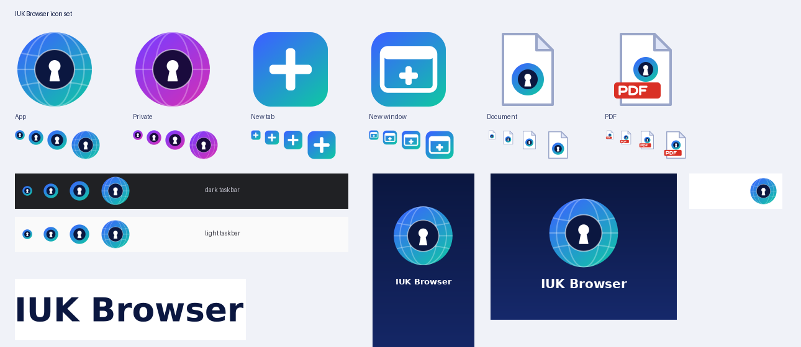

# IUK Browser

A Gecko (Firefox ESR) based browser with its own name, icons and branding, plus:

- **Encrypted sync of bookmarks and passwords** between devices that share the same *user name + secret connectivity key*
- A built-in **password manager** (vault, autofill, save prompt, generator, CSV import/export)
- **Themes** (7 presets + custom colors) and **color invert** (global, per site, plus brightness/contrast/sepia)
- Packages for **DEB**, **RPM** and **Windows** (installer + portable zip)



## What is in this repository

| Part | What it is | Where |
|---|---|---|
| Extension | WebExtension for sync, vault, themes, invert | `extension/` |
| Relay server | Zero-dependency Node server storing one opaque encrypted blob per account | `server/` |
| Branding | SVG artwork, icon generator, and a script that rebrands a Firefox source tree | `branding/` |
| Source build | mozconfigs + `build/build-source.sh` (Firefox ESR → IUK Browser) | `build/` |
| Packaging | DEB/RPM (nfpm), Windows NSIS installer + zip | `packaging/` |
| Distribution layer | `policies.json`, autoconfig (quick bundles only) | `distribution/` |

## Two ways to get a browser

1. **Source build (recommended, publishable).** Builds Gecko from the Firefox ESR source with the *unofficial branding* path and `browser/branding/iuk-browser`. No Mozilla name, logo or update servers, so you may redistribute the binaries. See [docs/BUILD-FROM-SOURCE.md](docs/BUILD-FROM-SOURCE.md).
   ```bash
   build/build-source.sh          # 1-4 hours, ~40 GB disk; outputs dist/*.deb and dist/*.rpm
   ```
2. **Quick bundle (personal use).** Downloads the official Firefox ESR, overlays the IUK layer and icons in minutes. These binaries are still Mozilla's, so keep them private.
   ```bash
   packaging/build-bundle.sh linux 0.1.0     # DEB + RPM
   packaging/build-bundle.sh windows 0.1.0   # setup.exe + portable zip
   ```

## Icons everywhere

One logo (a globe with a keyhole) drawn in `branding/src/*.svg` and rendered natively at every size, with a simplified bold version for 32 px and below so it stays crisp in the title bar and taskbar:

window / taskbar / **minimized window** / alt-tab (Linux hicolor + `StartupWMClass`), `.exe` and Start-menu shortcuts, jump-list "new tab / new window / private window", private-browsing variant, HTML and PDF document icons, About dialog and wordmark, Windows tiles, installer header/side art, DEB/RPM menu entry, extension toolbar button and add-on manager.
`apply_to_source.py` replaces **all 40 images** of the Firefox ESR 153 branding template at their original pixel sizes. Preview: `branding/preview.png`.

```bash
pip install -r branding/requirements.txt
python3 branding/generate.py      # re-render branding/generated/, extension icons and preview after editing the SVGs
```

## How sync and the vault work

1. You enter the same **user name** and **secret key** on each device.
2. PBKDF2-HMAC-SHA256 (600,000 iterations, salt = user name) yields 512 bits: the first 256 become the **AES-256-GCM key** (never leaves the device, non-extractable), the last 256 the **server token**. Knowing the token tells you nothing about the key.
3. Bookmarks and logins merge per item (last write wins, tombstones for deletes, 90-day clean-up), are encrypted, and are uploaded with optimistic concurrency (`If-Match`). The server sees only ciphertext.
4. The vault is also encrypted at rest on the device and decrypted only in memory after you unlock. It locks on every restart.

Bookmarks are keyed by URL and keep their folder path (Toolbar / Menu / Other). Passwords are keyed by `site|username`, so the same login created on two devices merges instead of duplicating.

**Choose a strong key.** Anyone holding the encrypted blob can guess offline. Use the built-in generator (32 random characters) and store the key safely: it cannot be recovered. A mistyped key on a *new* device does not error; it is simply a different, empty account. If nothing syncs, re-check the key.

## Relay server

```bash
PORT=8787 HOST=127.0.0.1 DATA_DIR=/var/lib/iuk-browser node server/server.js
```
Put it behind HTTPS, for example Caddy: `sync.example.com { reverse_proxy 127.0.0.1:8787 }`, and set `TRUST_PROXY=1`. On each device: toolbar icon → *Set up IUK Browser* → same user name, key and server URL.

## Development

```bash
npm install
npm test                 # crypto, merge, display CSS, relay, two-device sync
npm run lint             # web-ext lint
npx web-ext run --source-dir extension
```

| Shortcut | Action |
|---|---|
| `Ctrl+Shift+L` | Fill the saved login on this page |
| `Alt+Shift+I` | Toggle color invert on all sites |

## Publishing to GitHub over SSH

See [docs/GITHUB.md](docs/GITHUB.md) or run `scripts/publish-to-github.sh git@github.com:<user>/iuk-browser.git`. Publish the source, the extension, and **source-build** binaries. Do not attach the Mozilla-branded quick bundles.

## Known limitations

- The full Gecko compile was not run in the authoring environment; the branding step was verified against the real ESR 153 template, packaging was verified with a stand-in tarball, and the extension/relay/sync logic is covered by tests. Follow the first-build checklist in [TODO.md](TODO.md).
- The internal binary is still named `firefox`; everything user-visible (name, icons, window class, desktop entry) is IUK Browser.
- Firefox's built-in password manager is disabled by policy (extensions cannot read it); use *Import CSV* to migrate.
- Autofill works in the top frame only, on explicit action, to resist hidden-form phishing.
- Quick bundles use an unsigned add-on workaround that Firefox honors on ESR/unbranded builds; source builds use `--with-unsigned-addon-scopes=app,system` instead.
- Windows quick bundles keep Firefox's embedded `.exe` icon; shortcuts, installer and jump-list use IUK icons. A source build fixes this.

## Roadmap

See [TODO.md](TODO.md): **QR pairing** and **Argon2id** are planned next; then the first-build verification, auto-update channel and Windows CI.

## License

MIT for this repository. Firefox/Gecko is MPL-2.0 and remains Mozilla's.
